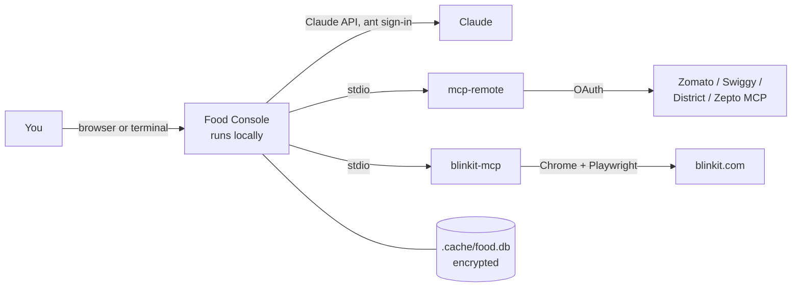

# Food Console

Search, order, book and analyse across **Zomato, Swiggy (Food, Instamart, Dineout),
District, Zepto and Blinkit** from one chat or one local web dashboard, powered by Claude
and each service's MCP server. Anything that changes your account or spends money waits
for your explicit approval.

> Unofficial personal project. Not affiliated with or endorsed by Zomato, Swiggy,
> District, Zepto, Blinkit or Anthropic.

---

## TL;DR

**What it is:** a local app that connects Claude to your food-delivery, grocery and
going-out accounts. You can ask things like "find a high-protein lunch under 600 kcal near
me", "compare my Zomato and Swiggy spending this month" or "add milk and eggs to my
Instamart cart", and see your combined order history as a dashboard.

**Quick start** (macOS, Python 3.11+, Node 18+, [uv](https://docs.astral.sh/uv/)):

```bash
git clone https://github.com/<you>/food-console.git && cd food-console
uv sync                                  # install dependencies
brew install anthropics/tap/ant          # Claude CLI, used for sign-in (no API key needed)
ant auth login                           # sign in to Claude once
uv run food-auth login --app zomato      # sign in to the services you use (browser opens)
uv run food-ui                           # start the web dashboard
```

**What you get:**

| | |
|---|---|
| **Chat** | One conversation across every connected service; UPI payments shown as a QR you scan |
| **Actions** | Every tool every service offers, as a form you can run by hand |
| **Pick** | Dishes near a saved address ranked by calories and protein (or a no-limits **treat**), with distances |
| **Usage** | Tokens and estimated cost of every chat message, Pick search and Stats refresh |
| **Stats** | Combined order history: spend over time, platforms compared, health score, every order with timestamps |

Each request goes to the cheapest Claude model that suits it (Haiku 5.5 for lookups,
Sonnet 5.5 for search and ordering, Opus 5.5 for analysis); you can override it.

**Safety in one breath:** runs only on your machine; anything not known to be read-only
asks before running; payments happen only in your UPI app with your PIN (the app shows
the QR, it never pays); personal data in the local cache is encrypted with a key in your
macOS Keychain; the web UI is bound to `127.0.0.1` behind a one-time sign-in link.

---

## Contents

- [Features](#features)
- [Supported services](#supported-services)
- [How it works](#how-it-works)
- [Requirements](#requirements)
- [Setup](#setup)
- [Using the web dashboard](#using-the-web-dashboard)
- [Using the terminal apps](#using-the-terminal-apps)
- [Pick: what to order by calories and protein](#pick-what-to-order-by-calories-and-protein)
- [Stats: your combined order history](#stats-your-combined-order-history)
- [Usage: tokens per run](#usage-tokens-per-run)
- [Model routing](#model-routing)
- [Service notes](#service-notes)
- [Payments](#payments)
- [Safety and privacy](#safety-and-privacy)
- [Local cache](#local-cache)
- [Configuration](#configuration)
- [Command reference](#command-reference)
- [Troubleshooting](#troubleshooting)
- [Development](#development)
- [Limitations](#limitations)
- [Credits and licence](#credits-and-licence)

---

## Features

- **One chat, every service.** Claude sees the tools of all connected services at once,
  so a single conversation can compare a dish on Zomato and Swiggy, then book a table on
  District.
- **Approval before anything changes.** Carts, addresses, bookings, orders and payments
  show an approval card (web) or a `y/N` prompt (terminal) with the exact arguments.
- **Dish picker.** Ranks dishes near a saved address against a calorie cap, a protein
  minimum, a price limit and veg/non-veg, or as a no-limits **treat**. A craving is the
  only thing searched. Uses the platform's own nutrition numbers and distances when it
  publishes them, checks nutrition for obvious errors, and clearly marks estimates.
- **Safe payments.** UPI payment requests are shown as a QR with the payee and exact
  amount; you pay in your UPI app with your PIN. Ways to pay without a PIN are off by
  default.
- **Model routing and usage tracking.** Each request goes to Haiku, Sonnet or Opus 5.5
  depending on the task, and the Usage tab shows tokens and estimated cost per run.
- **Combined stats.** Spend, orders, savings, fees, delivery times, a weekday × hour
  heatmap, top places and items, a rough eating-habits score, and a full order table with
  CSV export. Filter by date range and platform, or compare platforms side by side.
- **Works through rate limits.** Read-only answers are cached (encrypted); if a service is
  offline or throttling you, the last answer is shown and clearly marked as cached.
- **Manual mode.** The Actions tab lets you run any tool yourself with a generated form.

## Supported services

| Service | What it covers | Connection | Sign-in |
|---|---|---|---|
| **Zomato** | Restaurant delivery | Official MCP server `https://mcp-server.zomato.com/mcp` | Browser (OAuth) |
| **Swiggy Food** | Restaurant delivery | Official `https://mcp.swiggy.com/food` | Browser (OAuth) |
| **Swiggy Instamart** | Groceries | Official `https://mcp.swiggy.com/im` | Browser (OAuth) |
| **Swiggy Dineout** | Table bookings | Official `https://mcp.swiggy.com/dineout` | Browser (OAuth) |
| **District** (by Zomato) | Dining and table bookings, movies, events | Official `https://mcp-server.district.in/v2/mcp` | Browser (OAuth) |
| **Zepto** | Groceries, Zepto Cafe | Official `https://mcp.zepto.co.in/mcp` | Browser (OAuth) |
| **Blinkit** | Groceries | **Unofficial**: drives blinkit.com in a Chrome window ([details](#blinkit-unofficial)) | Phone number + SMS OTP |

The official servers are reached through [`mcp-remote`](https://www.npmjs.com/package/mcp-remote)
(pinned to an exact version), which handles each service's OAuth login and stores the
tokens in `~/.mcp-auth`.

## How it works



1. The app starts each service's MCP server as a local subprocess and collects its tools.
2. A router picks the Claude model for the task (see [Model routing](#model-routing)).
   Your message and the tool list go to that model, which decides which tools to call.
3. The app runs each tool call locally. Read-only calls run straight away; anything else
   waits for your approval. Results go back to Claude until it has an answer.
4. Calculations that must be exact (stats, rankings, nutrition checks) are done in plain
   Python, not by the model.

## Requirements

| Requirement | Why | Check |
|---|---|---|
| macOS (Linux likely works; untested) | Keychain is used for the cache key | |
| Python 3.11+ | The app | `python3 --version` |
| [uv](https://docs.astral.sh/uv/) | Installs and runs the project | `uv --version` |
| Node.js 18+ | `npx` runs `mcp-remote` for the official servers | `node --version` |
| [`ant` CLI](https://platform.claude.com/docs/en/cli-sdks-libraries/cli/quickstart) | Claude sign-in (no API key) | `ant auth status` |
| Google Chrome | Only for Blinkit | |
| Accounts on the services you want | Swiggy needs at least one saved address and payment method; all services are India-only | |

## Setup

### 1. Install

```bash
git clone https://github.com/<you>/food-console.git
cd food-console
uv sync
```

### 2. Sign in to Claude

The app uses your `ant` CLI sign-in instead of an API key.

```bash
brew install anthropics/tap/ant
ant auth login        # opens a browser; stores a profile in ~/.config/anthropic/
ant auth status       # should show an active profile
```

The app removes `ANTHROPIC_API_KEY` / `ANTHROPIC_AUTH_TOKEN` from its own environment at
startup, because either one (even empty) would take precedence over the profile. To use a
different profile, pass `--profile <name>` or set `ANTHROPIC_PROFILE`.

### 3. Sign in to the services

Sign in once per service; tokens are reused afterwards.

```bash
uv run food-auth login --app zomato      # browser login
uv run food-auth login --app swiggy      # three browser logins, one after another
uv run food-auth login --app district
uv run food-auth login --app zepto
uv run food-auth login --app blinkit     # asks for your mobile number and the SMS OTP in the terminal
uv run food-auth status                  # shows every service: logged in / not logged in
```

`--app all` (the default) signs in to everything. Each browser login waits up to
`--timeout` seconds (default 300).

### 4. Check everything connects

```bash
uv run zomato-chat tools     # lists Zomato's tools and which ones need approval
uv run pytest -q             # optional: runs the test suite (no accounts needed)
```

### 5. Start

```bash
uv run food-ui               # web dashboard (recommended)
uv run zomato-chat           # or a terminal chat
```

`food-ui` prints a **one-time sign-in link** such as
`http://127.0.0.1:8765/login?t=…` and opens it. Each link works once; a fresh one is
printed for the next browser. Stop with Ctrl+C.

## Using the web dashboard

```bash
uv run food-ui                                   # every service in mcp_config.json
uv run food-ui --server zomato-mcp --server swiggy-food   # only some services
uv run food-ui --no-browser --port 9000          # don't open a browser; another port
```

The header shows each service as connected or offline. Offline services are retried in
the background (every 2 minutes, backing off to 15); click one to retry immediately.

### Chat

Ask in plain language across all services. Tool activity appears as chips (marked
"cached" when the answer came from the local cache). When Claude wants to do something
that is not read-only, an **approval card** shows the tool and its exact arguments;
nothing runs until you click **Approve and run**. Each reply starts with a small chip
naming the model that answered and why; the **Model** menu under the chat box overrides
the automatic choice. When an order needs a UPI payment, a [payment card](#payments)
shows the QR, payee and amount, and **I've paid — check status** confirms the order.

Example prompts:

- "Find biryani places near me rated 4+ that deliver in under 30 minutes."
- "What did I spend on food delivery last month, and which cuisine did I order most?"
- "Compare milk, eggs and bread prices on Zepto and Instamart."
- "Book a table for 4 on District this Saturday at 8."
- "What movies are showing near me this weekend?"

### Actions

Every tool from every service, grouped and searchable, with a form generated from the
tool's input schema (or raw JSON). Read-only tools run directly; anything else shows a
confirmation step first. Results show whether they came live or from the cache.

### Pick

See [Pick](#pick-what-to-order-by-calories-and-protein).

### Usage

See [Usage](#usage-tokens-per-run).

### Stats

See [Stats](#stats-your-combined-order-history).

## Using the terminal apps

Every terminal command is the same program with a different default service set:

| Command | Services |
|---|---|
| `zomato-chat` | Zomato |
| `swiggy-chat` | Swiggy Food, Instamart, Dineout (tools prefixed `food_`, `instamart_`, `dineout_`) |
| `district-chat` | District |
| `zepto-chat` | Zepto |
| `blinkit-chat` | Blinkit |
| `zomato-chat --provider all` | Everything |

```bash
uv run zomato-chat                         # interactive chat
uv run swiggy-chat --server swiggy-instamart   # just one Swiggy server
uv run zomato-chat --no-orders             # browse and analyse only; account-changing tools blocked
uv run zomato-chat -v                      # also print tool arguments
uv run zomato-chat ask "Analyse my last 3 months of orders: spend per month, top 5 restaurants"
uv run zomato-chat tools                   # list tools and which need approval
uv run zomato-chat logout                  # delete this service's saved login
```

Inside the chat: `/tools`, `/usage` (token counts), `/reset` (new conversation), `/quit`.
When a tool needs approval, the arguments are printed and you answer `y` or `N`.

## Pick: what to order by calories and protein

Find dishes near a saved address that fit a calorie and protein goal, or a treat with no
limits at all.

**Web:** the **Pick** tab. Choose a goal preset or your own limits, optionally a craving
("chicken", "paneer", "south indian"), the delivery address, veg / non-veg and platform,
then **Find dishes**. **Deliver to** lists your saved Zomato and Swiggy addresses (read
directly from each platform, no Claude call); the other platform's saved address at the
same place is matched automatically, and a platform with no matching address is skipped
and noted. Only addresses that are really in your saved list are accepted.
Each dish shows its restaurant's **distance from that address** (e.g. "1.3 km from
Office"), read directly from the platform's search results (Zomato `distance`, Swiggy
`distanceKm`) rather than from the model; the address card shows the nearest and median
distance. Dishes whose platform didn't state a distance show none.
You get a calories-vs-protein chart with your target zone shaded, the best picks, and a
card per dish with its goal checks, where its numbers came from, and **Order in chat**.

**Terminal:**

```bash
uv run zomato-chat pick chicken                           # preset "lean"
uv run zomato-chat pick --goal protein --diet veg
uv run zomato-chat pick paneer --max-kcal 500 --min-protein 25 --max-price 300 --sort per_rupee
uv run swiggy-chat pick "south indian" --goal light
```

| Preset | Limits | Ranked by |
|---|---|---|
| `lean` (default) | ≤ 650 kcal, ≥ 30 g protein | protein per 100 kcal |
| `protein` | ≥ 40 g protein | most protein |
| `light` | ≤ 450 kcal, ≥ 15 g protein | fewest calories |
| `value` | ≤ ₹300, ≤ 800 kcal, ≥ 25 g protein | protein per ₹100 |
| `treat` | **No calorie or protein limits** (any given are ignored); price and diet still apply | best rated |

`--max-kcal`, `--min-protein`, `--max-price`, `--diet any|veg|non_veg`,
`--sort density|protein|kcal|per_rupee|rating|indulgent`, `--address <saved label>` and `--top N` override
or refine a preset.

**Where the numbers come from:**

- Claude gets **only read-only search, menu and address tools** for Pick (no carts,
  orders or history) and proposes candidate dishes, each with its own per-serving
  estimate of calories, protein, carbs and fat.
- **The craving is the only search.** If you enter one, every search uses exactly that
  keyword (case and punctuation aside): a search with any other or extra keyword, or with
  none, is refused before it runs, and dishes Claude marks as not matching the craving are
  left out (the result says how many). Menus are read only for restaurants that search
  returned. With no craving, Claude picks searches that suit the goal.
- **Zomato publishes nutrition for many dishes.** Those numbers are read directly from
  Zomato's raw responses by item ID in Python (not copied by the model) and shown as
  "Zomato-listed". A value the model says came from a tool is accepted only if it really
  appears next to that item in the tool output.
- **Listed values are sanity-checked.** If the macros don't add up to the calories, the
  value is far from a typical serving (some menus list a full thali at 27 kcal), or it is
  implausibly low for the price, the dish is ranked on the estimate instead and the card
  says why. Listed values that pass but differ a lot from the estimate are used with a
  note.
- Dishes that meet every limit come first, then the chosen ranking applies.
- **Treat yourself** (`treat`) is for an indulgent meal: calories and protein are not
  limited or ranked on (they are still shown for information), Claude searches comfort food
  such as pizza, burgers, biryani, fried chicken and desserts unless you give a craving, and
  results are ranked by restaurant rating, or by **most indulgent** (most calories).
- Estimates are for one serving as sold and can be off by 20–30%. **Not medical advice.**
- **Order in chat** pre-fills a chat message; the cart and checkout still need your
  approval.

Pick searches restaurant delivery (Zomato and Swiggy Food). The last result is saved
(encrypted) and shown when you reopen the tab.

## Stats: your combined order history

Click **Refresh from accounts** in the Stats tab. Claude calls only the read-only
order-history tools of each service and returns your orders as structured data; every
number on the page is then computed in Python.

- **Merged over time.** Each refresh is merged into the encrypted local store, so history
  grows even though services only return recent orders (Swiggy Food at most 15,
  Instamart about 15 days, Dineout none).
- **Platform filter:** Combined, Zomato, Swiggy, Swiggy Food, Instamart, District, Zepto
  or Blinkit. Everything on the page follows the choice.
- **Compare:** platforms side by side (by platform or by service): spend and share, share
  bars, spend over time on one axis, a scorecard for per-order savings, fees, delivery
  time, health, late-night share and cancellations, health gauges and top places.
- **Time range:** 7 / 30 / 90 days, this month, last month, this year, all time, or custom
  dates. KPIs show the change against the previous period of the same length.
- **Charts:** spend over time, per-service split, savings and fees, payment methods,
  delivery times, weekday × hour heatmap, top places and items, highlights.
- **Health score:** a rough 0–100 eating-habits score with its factors (indulgent vs
  healthy share, late-night orders, deliveries per week, fried food, sugary drinks,
  desserts, fruit and vegetables, vegetarian share), based on item names. **Not medical
  advice.**
- **All orders:** sortable, searchable table with placed and delivered timestamps,
  delivery minutes, items, status, payment, savings and totals; click a row for details;
  export as CSV (cells that a spreadsheet would treat as formulas are neutralised).

How services map into Stats: District dining is service `dineout` and tickets are
`events` (tagged non-food); Zepto is `grocery` (or `food` for Zepto Cafe); Blinkit is
`grocery`.

A refresh can use many output tokens when there are large grocery orders (capped at 128K
per refresh); most refreshes use far less.

## Usage: tokens per run

The **Usage** tab records every run - one chat message, one Pick search, one Stats refresh,
or one terminal command - with its token use and an estimated cost:

- **Totals** for today, 7 days, 30 days or all time: tokens, estimated cost, how much input
  came from the prompt cache, output tokens.
- **Tokens per day** (cache reads, new input, cache writes, output) and **by activity**
  (Chat, Pick, Stats, Terminal).
- **Every run**, with its request text, number of API calls and tool calls, tokens, cache
  share, cost and duration. Click a run to see each API call (prompt size, cache read and
  write, output, cost, which tool it called next) and the biggest tool results.

Why a single order can use a lot: every API call in a run re-sends the same starting prompt
(instructions, every tool definition of every connected service, and the conversation so
far), plus each tool result from earlier calls. Placing an order takes many calls (search,
menu, cart, payment options, place order, payment status, confirm), so that base is sent
10+ times. The prompt cache makes repeats cost 5% of new input, which is why the cache
share is usually high, but it still adds up; the run detail shows the starting prompt size
so you can see it.

Costs are estimates at Claude API list prices for the model each call used (see
[Model routing](#model-routing)); routing calls are included, and billing through your
`ant` sign-in may differ. The history is stored encrypted in `.cache/food.db` (it includes your
messages); **Clear history** in the tab or `food-cache clear usage` deletes it.

## Model routing

Each run is sent to the cheapest model that suits it:

| Tier | Model | Used for | Price per million tokens (input / output) |
|---|---|---|---|
| light | Claude Haiku 5.5 | Lookups and status: saved addresses, cart, order tracking, recent orders, payment status | $0.10 / $0.50 (prompts up to 100K tokens) |
| standard | Claude Sonnet 5.5 | Search and compare, menus, carts, coupons, orders, bookings, payments; **Pick** and **Stats refresh** | $2 / $10 |
| complex | Claude Opus 5.5 | Analysis and planning: spending or health across history, multi-service plans, open-ended requests | $4 / $20 |

- **How chat messages are routed:** a small Claude Haiku 5.5 call (no tools, a few hundred
  tokens, a tiny fraction of a cent) reads the message and the last few turns and picks a
  tier; when unsure it picks the higher one. Pick and Stats refresh always use the standard
  tier, with no routing call.
- **Only up within a conversation.** Once a conversation has used a larger model it stays
  there: moving to a smaller model mid-conversation would drop the earlier turns' reasoning
  and restart the prompt cache, while moving up keeps both. **New conversation** starts
  from the bottom again.
- **Only the model changes, never the tools.** Changing the tool list mid-conversation
  invalidates earlier reasoning, so every tier gets the same tools.
- **You can override it:** the **Model** menu under the chat box (Auto, Haiku 5.5, Sonnet
  5.5, Opus 5.5; your choice wins, even mid-conversation), or `--model auto|haiku|sonnet|opus`
  in the terminal apps.
- **You can see it:** each reply in Chat starts with a chip naming the model and why
  ("Sonnet 5.5 · auto · reorder: build cart and place order"); the **Usage** tab shows the
  model per run and a **By model** split, with routing calls included in the cost.
- If the routing call fails, the standard tier is used. Refusal fallbacks
  (`fallbacks: "default"`) are sent only with Opus requests.

Settings: `FOOD_ROUTER=off` sends everything to `FOOD_MODEL` (or `ZOMATO_CHAT_MODEL`,
default Claude Opus 5.5); `FOOD_MODEL_LIGHT`, `FOOD_MODEL_STANDARD`, `FOOD_MODEL_COMPLEX`
change a tier's model; `FOOD_ROUTER_MODEL` changes the routing model.

## Service notes

### Zomato

Zomato's server doesn't label which tools are read-only, so only the tools listed under
`readOnlyTools` in [`mcp_config.json`](mcp_config.json) run without asking: order
history, order tracking, saved addresses, menus and restaurant search. Everything else,
including `create_cart`, `checkout_cart` and `bind_user_number*`, and any tool Zomato adds
later, asks first.

### Swiggy

Swiggy labels its tools, and the labels are used as-is. `swiggy-chat` connects to Food,
Instamart and Dineout together; if one fails the others keep working.

### District

District routes almost everything through two generic tools: `search` (finds an
operation) and `execute` (runs read-only operations). Both are labelled read-only by
District, as are payment status and payment options. `act`, `pay`, `cancel_payment` and
the OTP login tools always ask.

### Zepto

Zepto labels search, cart view, order history and payment status as read-only. Placing an
order, changing the cart, addresses, store or name always ask. (Zepto marks its order tools
"not destructive" but not read-only; that is enough to require approval here.) Picking a
saved address or store also asks, so expect one approval per session before shopping.

### Blinkit (unofficial)

Blinkit has no official MCP server. `blinkit-mcp` (in
[`src/food_console/blinkit/`](src/food_console/blinkit)) drives blinkit.com in a
**visible Google Chrome window** with Playwright. It is a safety-focused rewrite of the
approach in [hereisSwapnil/blinkit-mcp](https://github.com/hereisSwapnil/blinkit-mcp) (MIT).
It uses the website the way you would, so it can break when Blinkit changes its pages, and
automating the site may be against Blinkit's terms. **Use at your own risk.**

- **Chrome window:** Blinkit blocks headless browsers with a bot check, so the window is
  visible. It opens only when a Blinkit tool is first used. If a check appears, solve it in
  that window; nothing tries to hide the automation.
- **Login:** `uv run food-auth login --app blinkit` (mobile number + SMS OTP), or ask in
  chat (the OTP steps ask for approval). The session is stored **encrypted** in
  `.cache/blinkit_session.enc`; `food-auth logout --app blinkit` deletes it.
- **Location:** from a saved address (`list_addresses` / `select_address`) or a place you
  name (`set_location`). There is no IP-based location lookup.
- **Read-only tools:** `status`, `search`, `view_cart`, `list_addresses`, `order_history`.
  Everything else asks; `remove_from_cart`, `place_order` and `logout` are marked
  destructive.
- **Money guard:** `checkout(expected_total_inr)` and
  `place_order(payment, expected_total_inr)` refuse to continue unless the cart total
  equals the total you approved. Any later cart or address change voids that total. The
  payment method (`cod` or `upi_qr`) must be chosen explicitly. A UPI QR is shown as a
  payment card (see [Payments](#payments)).
- **Tested live while logged out:** location search, product search (price, MRP,
  discount, ETA, sponsored flag), add/remove, cart and bill parsing, and the total guard.
  Login, saved addresses, the payment page and order history need a logged-in account and
  follow the original project's page selectors; they report what they saw rather than
  assuming success.

<details>
<summary>What changed from the original Blinkit project, and why</summary>

| Original | Here |
|---|---|
| `SERVE_HTTPS=true` exposes the server on `0.0.0.0:8000` with no authentication | stdio only, no network listener |
| No tool labels, so clients may run `pay_now` / `checkout` without asking | read-only / destructive labels; non-read-only tools need approval |
| Payment method auto-picked (cash on delivery if available) | `cod` / `upi_qr` must be chosen; total must match what the user approved |
| Session cookies (incl. access token) in plaintext `~/.blinkit_mcp/cookies/auth.json` | encrypted with the Keychain key, owner-only file |
| Location from `http://ip-api.com` (third party, plain HTTP) on every start | no IP lookup; saved address or a place you name |
| `start.sh` installs uv with `curl … \| sh` and re-downloads Firefox every start | normal dependency; uses installed Chrome |
| Payment API failure bodies printed into tool output | not logged |
| Product ID interpolated into a CSS selector unchecked | IDs must be numeric |

</details>

## Payments

The official servers (Swiggy, District, Zepto) expect a chat app that displays their
payment widget. This app shows the same thing as a **payment card** in Chat (and under the
result in Actions):

- **UPI QR:** for a UPI payment request (`upi://pay…`, or app-specific links such as
  `tez://upi/pay…`), the card shows the exact amount, the payee name and UPI ID, and a QR
  code drawn locally from the platform's own request, unchanged. Scan it with any UPI app.
- **QR images** sent by the service are shown as they are.
- **Payment links** on payment gateways (Razorpay, Paytm, PhonePe, Juspay, Cashfree, PayU,
  BillDesk), or on the services' own payment pages, get a QR and an **Open payment page**
  button. Links on any other site are never turned into a card.
- **I've paid — check status** asks Claude to check the payment status and confirm the
  order. Claude is told never to call an order placed before that.

How this keeps paying safe:

- **You pay, not the app.** Money only moves when you approve it in your UPI app with your
  PIN. Nothing in this app can complete a payment, and it stores no card, UPI or wallet
  details.
- **Check before your PIN.** The card shows the payee and the exact amount (paise
  included); your UPI app shows them again before you enter the PIN.
- **Only from account-changing tools.** Payment cards are built only from results of tools
  that needed your approval (placing an order, paying). A UPI link inside a menu, review or
  search result is never shown as a card.
- **No PIN-less payment by default.** Ways to pay without your PIN are turned off with
  `blockedTools` in `mcp_config.json`: Zepto's wallet (`create_wallet_order`) and UPI
  Reserve Pay (`create_upi_reserve_pay_order`, a pre-authorised mandate). Remove an entry
  to allow it; it still asks for approval.
- **Cash on delivery** remains available where the service offers it.

About "payment MCP servers": the ones that exist (Razorpay, Paytm, Juspay) are for
merchants collecting money, not for paying as a customer. Giving an agent a way to pay
without your PIN (stored wallet, card or mandate) is exactly what this app avoids.

In the terminal apps, a UPI QR is printed in the terminal, a payment link is printed as a
URL, and a QR image is saved owner-only to `.cache/` and opened.

## Safety and privacy

### Approval gate

Any tool that is not known to be read-only needs your explicit approval: `y` in the
terminal, **Approve and run** in the web UI. "Known read-only" means the service labels the
tool read-only, or, for services that send no labels (Zomato), the tool is listed in
`readOnlyTools` in `mcp_config.json`. Tool names alone are never trusted. Declined calls
are reported back to Claude as errors and it is told not to retry them. `--no-orders`
blocks non-read-only tools outright.

### What stays on your machine

- The app, the MCP servers and the web UI run locally.
- Service logins: `mcp-remote` tokens in `~/.mcp-auth`; the Blinkit session encrypted in
  `.cache/`.
- Cache, saved orders, last pick and token-usage history: encrypted in `.cache/food.db`
  (see [Local cache](#local-cache)).
- Logs: `.cache/logs/<server>.log` (request names, not personal data).

### What leaves your machine

- Your messages and the tool results needed to answer them go to Claude (Anthropic API).
- Tool calls go to the respective service (Zomato, Swiggy, District, Zepto, Blinkit).

### Web UI protections

- Listens on `127.0.0.1` only and rejects any other `Host` header (blocks DNS rebinding).
- One-time sign-in link sets an `HttpOnly`, `SameSite=Strict` session cookie; the link
  stops working after use.
- Every API call also needs an `X-Food-Console` header, which other websites can't send.
- Strict Content-Security-Policy, `X-Frame-Options: DENY`, `Referrer-Policy: no-referrer`.
- All model and tool text is HTML-escaped before rendering.

### Other safeguards

- `mcp-remote` is pinned to an exact version in `mcp_config.json` (update it
  deliberately).
- `.cache/` is owner-only (`0700`), its files `0600`.
- Status-like tools (payment status, order tracking, carts, OTP) always ask the service
  instead of reusing a cached answer.

### Known risks

- The app trusts each service's own read-only labels. A service that mislabelled a
  write tool as read-only would bypass the approval gate.
- Text from menus or product listings could try to steer Claude; anything that changes
  your account still needs your approval.
- When you log in to Blinkit from chat, the OTP passes through Claude and the approval
  card. `food-auth login --app blinkit` keeps it in your terminal.

## Local cache

`.cache/food.db` (SQLite, git-ignored, owner-only) is shared by `food-ui` and the terminal
apps. Personal data in it is **encrypted** (Fernet: AES + HMAC): cached tool arguments and
results, saved orders and their metadata, the last dish pick, and the token-usage history
(which includes your messages). Order IDs are stored
only as keyed hashes. The key lives in the **macOS Keychain** (item "food-console"; any
`keyring` backend on other systems), or in an owner-only `food.db.key` file when no
keychain is available. If the key is lost the cache is simply treated as empty. Tool lists
(public descriptions of each service's tools) are stored in plain text.

- **Read-only results are cached.** An identical read within `--cache-ttl` seconds
  (default 60; `0` = fallback only) is answered locally.
- **Fallback when a service is unavailable.** If a service is offline, rate-limited
  (HTTP 429) or a call fails, the last cached answer is returned, prefixed with
  `[Cached result from <time> (<age> ago), served because …]`, and marked "cached" in the
  UI.
- **Account-changing tools are never cached.** A successful one clears that service's
  cached results so the next read is fresh.
- **Tool lists are cached**, so a service that is down at startup still shows its
  read-only tools (labelled "offline · cache") if it has connected before.

```bash
uv run food-cache info                       # what is cached, per service
uv run food-cache clear                      # cached tool results (default)
uv run food-cache clear results --server food
uv run food-cache clear orders               # saved order history used by Stats
uv run food-cache clear picks                # last dish pick
uv run food-cache clear usage                # token usage history
uv run food-cache clear all
uv run food-cache clear all --forget-key     # also delete the database and its Keychain key
```

## Configuration

### Environment variables

| Variable | Default | Purpose |
|---|---|---|
| `ANTHROPIC_PROFILE` | active `ant` profile | `ant` profile used for Claude |
| `FOOD_ROUTER` | `auto` | `off` disables [model routing](#model-routing) |
| `FOOD_MODEL_LIGHT` / `_STANDARD` / `_COMPLEX` | Haiku / Sonnet / Opus 5.5 | Model for each routing tier |
| `FOOD_ROUTER_MODEL` | `claude-haiku-5-5` | Model that classifies chat messages |
| `FOOD_MODEL`, `ZOMATO_CHAT_MODEL` | `claude-opus-5-5` | The single model used when routing is off |
| `ZOMATO_CHAT_EFFORT` | `medium` | Reasoning effort when routing is off (`low` … `max`) |
| `FOOD_UI_PORT` | `8765` | Web UI port |
| `MCP_REMOTE_CONFIG_DIR` | `~/.mcp-auth` | Where `mcp-remote` keeps OAuth tokens |
| `FOOD_CONSOLE_KEY_BACKEND` | Keychain | Set to `file` to keep the cache key in a file instead |
| `BLINKIT_HEADLESS` | unset | `1` tries headless Chrome (usually blocked by Blinkit's bot check) |

### `mcp_config.json`

Server definitions, in the same `mcpServers` format as Claude Desktop, plus three extras:

```jsonc
{
  "mcpServers": {
    "zomato-mcp": {
      "command": "npx",
      "args": ["-y", "mcp-remote@0.17.1", "https://mcp-server.zomato.com/mcp"],
      // Only for servers that don't label their tools: the tools allowed to run without asking.
      "readOnlyTools": ["get_order_history", "get_saved_addresses_for_user", "..."]
    },
    "zepto-mcp": {
      "command": "npx",
      "args": ["-y", "mcp-remote@0.17.1", "https://mcp.zepto.co.in/mcp"],
      // Tools never offered to Claude or the Actions tab (here: ways to pay without your UPI PIN).
      "blockedTools": ["create_upi_reserve_pay_order", "create_wallet_order"]
    },
    "blinkit-mcp": {
      // "${python}" means "the Python running this app" (for servers shipped in this package).
      "command": "${python}",
      "args": ["-m", "food_console.blinkit.server"]
    }
  }
}
```

`--server <key>` (repeatable) picks servers from this file; `--config <path>` uses another
file.

Requests to Claude Opus enable server-side refusal fallback (`fallbacks: "default"`): if
the model declines a request for safety reasons, the API retries it on a fallback model.
Haiku and Sonnet requests don't send it.

## Command reference

| Command | What it does | Useful options |
|---|---|---|
| `food-ui` | Web dashboard | `--server`, `--port`, `--no-browser`, `--connect-timeout` (180 s), `--history-limit` (50), `--cache-ttl` (60 s), `--profile`, `--config` |
| `zomato-chat`, `swiggy-chat`, `district-chat`, `zepto-chat`, `blinkit-chat` | Terminal chat | `--provider`, `--server`, `--model`, `--no-orders`, `-v`, `--profile`, `--config`; subcommands `chat`, `ask`, `pick`, `tools`, `logout` |
| `food-auth` | Sign in / out / status | `login\|logout\|status`, `--app`, `--force`, `--timeout`, `--kill-stale` |
| `food-cache` | Inspect or clear the local cache | `info`, `clear [results\|tools\|orders\|picks\|usage\|all]`, `--server`, `--forget-key` |
| `blinkit-mcp` | The Blinkit MCP server on its own (stdio) | for use in other MCP clients |

`--app` accepts `all`, `zomato`, `swiggy`, `swiggy-food`, `swiggy-instamart`,
`swiggy-dineout`, `district`, `zepto`, `blinkit`.

## Troubleshooting

| Symptom | Cause and fix |
|---|---|
| `Claude auth failed` | The `ant` sign-in expired. Run `ant auth login`, check with `ant auth status`. |
| A service shows **offline: rate-limited (HTTP 429)** | The service is throttling your account. It clears by itself; the app retries automatically and serves cached read-only answers meanwhile. |
| **offline: not logged in or the login expired** | `uv run food-auth login --app <app>`. |
| **offline: timed out** | A first-time browser login wasn't finished. Run `food-auth login` first, then start the app. |
| Login hangs with `Another instance is running the sign-in for this server` | An earlier `mcp-remote` is still holding the login callback port. `food-auth status` shows it; close the other app, or run `food-auth login --app <app> --kill-stale`. |
| `Not signed in` in the web UI | Open the newest one-time link printed in the terminal; each link works once. |
| Blinkit: `could not start Google Chrome` | Install Google Chrome, or run `uv run playwright install chromium`. |
| Blinkit shows "Just a moment…" | Blinkit's bot check; solve it in the Chrome window. |
| Blinkit results are for the wrong area | Set the location first (`select_address` or `set_location`); search results warn when none is set. |
| Stats are empty | Click **Refresh from accounts**; Stats only shows what has been collected. |
| `saved orders can't be decrypted` | The cache key changed or is missing. Run `food-cache clear orders` and refresh. |

Service logs are in `.cache/logs/<server>.log`.

**Logging out** (`food-auth logout`) deletes the local tokens only. The services don't
offer token revocation, so to cut off access completely, also sign out of all sessions in
each service's app.

## Development

```bash
uv sync
uv run pytest -q          # 96 tests; no accounts or network needed (fake MCP servers)
```

### Project layout

```
src/food_console/
  __init__.py        terminal apps (zomato-chat, swiggy-chat, ...; chat / ask / pick / tools)
  agent.py           Claude tool-use loop, system prompt, approval gate, per-run usage
  mcp_bridge.py      providers, MCP sessions, schema normalisation, caching, reconnects
  auth.py            food-auth: login / logout / status
  store.py           encrypted SQLite cache (food-cache)
  stats.py           order-history extraction schema and all Stats metrics
  nutrition.py       dish picker: candidate schema, listed-nutrition parser, checks, ranking
  payments.py        payment cards: UPI QR from payment requests, QR images, payment links
  usage.py           token accounting per run: totals, cost at list prices, per-day, per-activity, per-model
  router.py          model routing: task routes, Haiku classifier, in-conversation ratchet
  web.py             web UI server (food-ui)
  static/index.html  web UI (single file, no external resources)
  blinkit/           unofficial Blinkit MCP server: parsers, encrypted session, Playwright driver
tests/               fake MCP servers and tests for every module
mcp_config.json      MCP server definitions
```

### Adding a service

1. Add the server to `mcp_config.json` (and `readOnlyTools` if it doesn't label its tools).
2. Add a `Provider` and its brand in `mcp_bridge.py`, and an `APPS` entry in `auth.py`.
3. Add it to `PLATFORMS` / `COMPARE_GROUPS` and the order schema in `stats.py`.
4. Add its colour and labels to the maps in `static/index.html`.
5. Sign in, run `<x>-chat tools`, and check which tools need approval.

## Limitations

- All services are India-only, and each only exposes what its MCP server offers (for
  example, Swiggy returns at most 15 recent food orders).
- The Blinkit integration is unofficial and depends on Blinkit's web pages; it can break
  without notice.
- Nutrition figures are platform data or estimates; the health score is a rough guide
  based on item names. Neither is medical advice.
- Claude API usage is billed to your Anthropic account; Stats refreshes and long chats use
  the most tokens. Every request re-sends the tool definitions of all connected services
  (about 63K tokens with all seven), mostly from the prompt cache; connect fewer services
  with `--server` to send less.

## Credits and licence

- Blinkit order-history parsing adapts code from
  [hereisSwapnil/blinkit-mcp](https://github.com/hereisSwapnil/blinkit-mcp)
  (MIT, © 2025 Swapnil Singh).
- Built on the [Model Context Protocol](https://modelcontextprotocol.io),
  [mcp-remote](https://www.npmjs.com/package/mcp-remote),
  [Playwright](https://playwright.dev) and the
  [Anthropic Python SDK](https://github.com/anthropics/anthropic-sdk-python).
- Zomato, Swiggy, District, Zepto and Blinkit are trademarks of their owners; this project
  is not affiliated with them.

No licence has been chosen for this repository yet.
